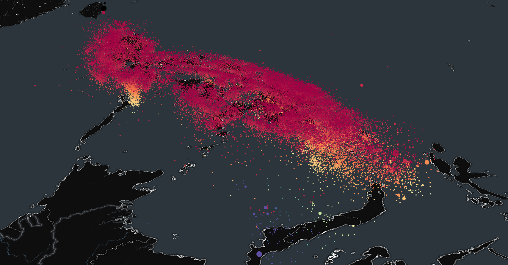

# Philippine Historical Earthquake Locator 3D

An interactive 3D web application for visualizing historical earthquake data within the Philippine region. This tool allows users to explore the location, magnitude, and depth of past seismic events dating as far back as 2018.

**Live Demo Link:** [**https://greturn.github.io/philippines-equake-locator-3d/**](https://greturn.github.io/philippines-equake-locator-3d/)



---

## Details

Built with TypeScript, Vite, and a custom WebGL2 3D WebMercator engine with precompiled multi-LOD vector basemap geometry (`BM4`) and two-tier columnar binary earthquake bundles (`EQC2`/`EQM1`/`EQL2`). Inspired by [japan-eq-locator](https://github.com/nagix/japan-eq-locator).

The historical earthquake data used in this project is sourced from the official public records of the **[Philippine Institute of Volcanology and Seismology (PHIVOLCS)](https://www.phivolcs.dost.gov.ph/)** via `phivolcs-earthquake-data-scraper` and automatically checks for daily updates at runtime (plus a daily GitHub Actions rebuild at 10:15 AM PHT).

**Disclaimer:** This tool is intended for educational and informational purposes only. It is **not** to be used for real-time monitoring or disaster response. Please always refer to official government agencies for alerts.

---

## 🚀 Getting Started (For Developers)

No API keys or Mapbox tokens are required.

1.  **Clone the repository:**
    ```bash
    git clone https://github.com/GReturn/philippines-equake-locator-3d.git
    ```

2.  **Navigate to the project directory:**
    ```bash
    cd philippines-equake-locator-3d
    ```

3.  **Install dependencies:**
    ```bash
    npm install
    ```

4.  **Start the dev server:**
    ```bash
    npm run dev
    ```

5.  Open [http://localhost:5173/philippines-equake-locator-3d/](http://localhost:5173/philippines-equake-locator-3d/) in your browser.

### Optional Data Scripts

- `npm run build:data` — Fetches the latest PHIVOLCS archive and recompiles the binary bundles in `public/data/`.
- `npm run build:basemap` — Rebuilds the multi-LOD vector basemap (`public/data/basemap.bin`).

---

## 🧪 Verification

Run `npm run build` and `npm run lint` to type-check, bundle, and lint the application.

---

## 📄 License

This project is licensed under the MIT License. See the `LICENSE` file for details.
